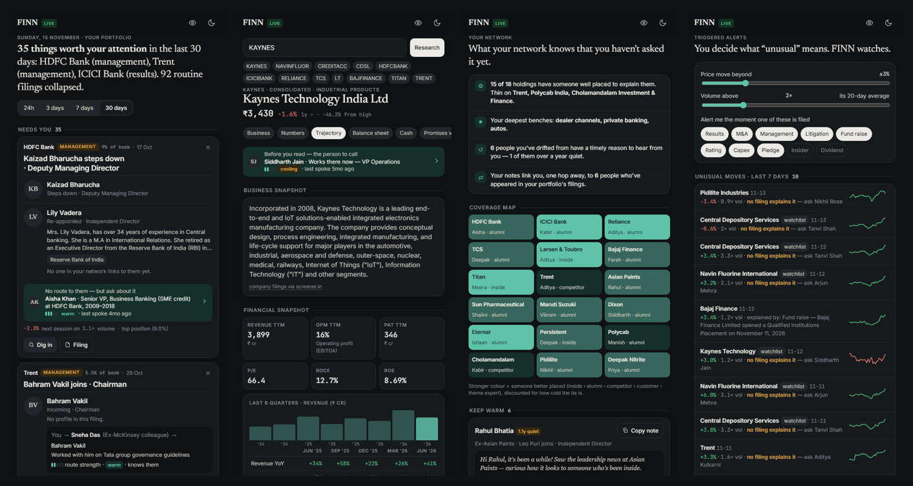
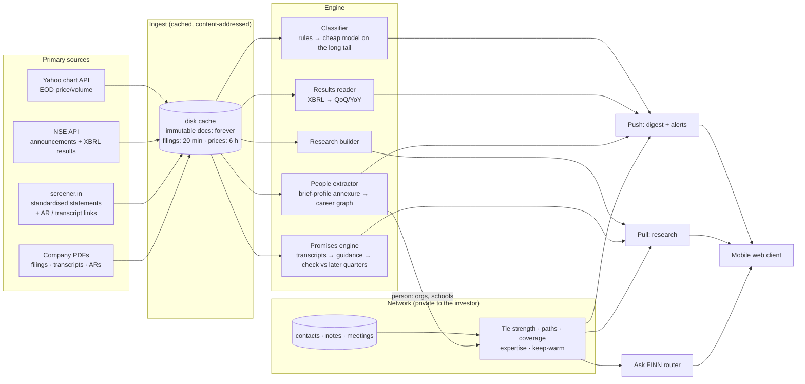

# FINN — a financial investment agent that knows who you know

Mobile-first prototype for the ENAM *Founding AI Engineer* build challenge.
**Push** tells you what changed in your book and why it matters, **Pull** dissects any NSE company from its own filings and concall transcripts, and the **Network** shows up inside both: on every card, the person in your network who can explain it.

> Live (backend): `<render-url>` · Static phone demo (no backend): https://darkrealm018.github.io/finn/
> Open either on a phone. It is built for one-handed use.



---

## What it does

| | |
|---|---|
| **Brief** (push digest) | Every NSE filing across an 18-stock portfolio for the window you pick (24h · 3d · 7d · 30d), classified, de-duplicated and ranked by *materiality × your interests × position size*. Material items get a card shaped for their type. Routine paperwork collapses to one line. |
| ↳ Results | Revenue/EBITDA/PBT/PAT, QoQ and YoY, **read from the results filing's own XBRL**. Banks show NII/PPOP and NBFCs show PPOP, because EBITDA is meaningless for lenders. The card also carries a one-line read (margin bp change, operating leverage) and the next session's price/volume reaction. |
| ↳ Management change | Who's coming or going, their bio **lifted from the filing's SEBI "brief profile" annexure**, and their career orgs/schools. Then your route to them: *You → Rohan Iyer (IIM-A classmate) → V. N. Srivatsan — "was in his compliance team at ICICI, 2016–20"*, with route strength. |
| ↳ Material events | M&A, capex, litigation, fund raises and rating actions name the best-placed contact and why: works there, alumni, competitor, customer, supplier, same group or theme expert. |
| **Watch** (triggered alerts) | Sliders for "unusual": price ±X%, volume Y× its 20-day average. Category subscriptions too. Each move is tagged *explained by a filing* or **"no filing explains it — ask Siddharth"**. |
| **Research** (pull) | Any NSE ticker: business snapshot and revenue mix, financial snapshot, 3/5/10-yr trajectory, balance sheet and working-capital cycle, cash conversion, **promised vs delivered** across the last four concalls, bull/bear, and who to call. |
| **Network** | Not a contact list. It shows what your network notices: a coverage map of your book (who's best placed on each holding and where you're thin), your deepest benches, an expertise map, people one hop away who appeared in filings, and "keep warm" nudges with a ready opener when a former employer just filed something material. |
| **Ask FINN** | One input, typed or **spoken**: "who knows Rajiv Dube", "prep me for Dixon", "experts on rural lending", "what changed this week". |

Privacy touches you can see in the UI: a one-tap **screen-share mode** blurs every name, and contacts never leave the instance.

## Run it

```bash
pip install -r requirements.txt
uvicorn backend.app:app --port 8000          # → http://localhost:8000 (open on your phone via LAN IP)
# optional
export ANTHROPIC_API_KEY=...                  # turns on the model tier (see below); everything works without it
export FINN_TOKEN=some-secret                # require ?t=some-secret on every API call
python scripts/build_snapshot.py             # re-freeze web/snapshot/ for the static demo
python -m pytest -q                           # 18 offline regression tests on real filing/transcript excerpts
```

Deploy: `render.yaml` (one-click Render web service) and `.github/workflows/pages.yml` (static demo on GitHub Pages). The client detects a missing backend and falls back to the frozen snapshot on its own.

## Architecture



**Key decisions** (full reasoning in [`docs/WRITEUP.md`](docs/WRITEUP.md)):

- **Read numbers, don't generate them.** Results come from XBRL, trajectory and cash from standardised statements, guidance quotes from transcripts with page numbers. Models are only ever handed numbers we computed.
- **Rules first, models on the long tail.** About 95% of filings are classified by auditable rules in microseconds. NSE's own subject line turned out to be unreliable (Dixon filed its Q2 results as "Change in Management"), so we classify on content.
- **Two-tier model routing.** When enabled, `claude-haiku-5-5` handles bulk extraction (classification fallback, profile → career graph, guidance extraction) and `claude-opus-5-5` handles judgement only (promise verdicts, bull/bear). Every call is schema-constrained and cached by content hash, so a transcript is paid for once, ever.
- **The network is a graph with reasons, not a list.** Every answer is *(contact, why, strength)*. Strength blends relationship type, recency and frequency, and cold-but-perfect contacts surface with a warm-up flag.

## Repo map

```
backend/
  app.py              FastAPI: /api/digest, /alerts, /research/{sym}, /network/*, /ask (+ serves web/)
  store.py            content-addressed disk cache, stale-on-error
  sources/            prices.py · nse.py (filings + XBRL) · screener.py · docs.py (PDF → text/turns)
  engine/             taxonomy.py · digest.py · people.py · research.py · promises.py · ask.py · llm.py
  network/graph.py    tie strength, who-knows-org, paths-to-person, expertise, keep-warm, graph
data/
  portfolio.json      18 holdings (+ weights) and 4 research names
  prefs.json          thresholds and category weights (edited from the app)
  orgs.json           org gazetteer: aliases, sector, peers, customers, suppliers, group
  network/contacts.json   SYNTHETIC investor network (28 people, notes, meetings)
  cache/              warm seed of public primary documents (immutable) so the demo is fast
web/                  index.html · app.css · app.js (no build step) · snapshot/ (frozen API for static hosting)
scripts/build_snapshot.py
tests/test_engine.py  offline regression tests — every fixture is a real excerpt that once broke a rule
```

## Data honesty

- Filings, results, transcripts, annual-report links and prices are **real, public, primary**: NSE, company PDFs, screener.in's standardised statements, Yahoo EOD.
- **Every contact in the network is fictional.** Real people (incoming CFOs, directors) appear only through their own exchange filings. Their bios are quoted from the SEBI-mandated profile annexure, not scraped from LinkedIn.
- The pull side uses **no news, no broker notes and no model memory**.
